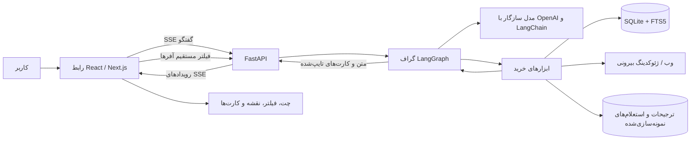

# گزارش فنی و محصولی «ترب حضوری»

این سند نمای کلی محصول، معماری، گردش داده، قابلیت‌های رابط، هسته‌ی ایجنت، قراردادهای خروجی، محدودیت‌ها و راه‌اندازی پروژه را توضیح می‌دهد. مبنای گزارش، کد و تنظیمات فعلی مخزن است؛ جزئیات رکوردهای دیتاست ممکن است با بارگذاری نسخه‌ی جدید تغییر کند.

## ۱. معرفی محصول

«ترب حضوری» یک راهنمای خرید فارسی و راست‌به‌چپ برای پیدا کردن کالا و فروشگاه حضوری در تهران است. کاربر می‌تواند با زبان طبیعی کالا را پیدا کند، بودجه و محدوده را تعیین کند، فروشگاه‌ها را روی نقشه و در فهرست ببیند، پیشنهادها را مقایسه کند و برای مراجعه یا استعلام نمونه‌سازی‌شده راهنمایی بگیرد.

هدف تجربه این است که کاربر را از «چه چیزی بخرم؟» تا «کجا بروم و چه چیزی را قبل از پرداخت بررسی کنم؟» همراهی کند. چت تنها راه کار با محصول نیست: فیلترها، کارت‌ها، نقشه و دکمه‌های اقدام هم در مسیر خرید نقش دارند.

### مسیر معمول کاربر

1. درخواست کالا را به فارسی می‌نویسد یا یکی از پیشنهادهای شروع را انتخاب می‌کند.
2. اگر درخواست بیش از حد کلی و اطلاعات خرید ناکافی باشد، ایجنت پیش از جست‌وجوی سنگین حداکثر یک سؤال کوتاه می‌پرسد.
3. ایجنت محصول یا محصولات مناسب را از دیتاست پیدا می‌کند و کارت‌های تایپ‌شده برمی‌گرداند.
4. کاربر مکان، بودجه، شعاع و شرایط خرید را از پنل فیلتر تنظیم می‌کند.
5. آفرهای همان محصول بر اساس فاصله، بودجه، بازبودن، قسطی حضوری و ارسال فوری فیلتر می‌شوند؛ نتیجه در نقشه و فهرست نمایش داده می‌شود.
6. کاربر می‌تواند گزینه‌ها را مقایسه کند، استعلام نمونه‌سازی‌شده بگیرد، جایگزین ببیند یا راهنمای مراجعه دریافت کند.

## ۲. معماری کلان

هسته‌ی گفتگو و ابزارها با Python ساخته شده است. FastAPI مرز HTTP را فراهم می‌کند، LangGraph گردش کار ایجنت را مدیریت می‌کند و رابط کاربری React/Next.js درخواست‌ها را به API می‌فرستد. SQLite منبع اصلی محصولات، فروشگاه‌ها و آفرهاست.



### اجزای اصلی

| بخش | فناوری و مسئولیت |
|---|---|
| رابط | React و Next.js App Router، TypeScript، RTL، فونت Vazirmatn |
| نقشه | Leaflet و کاشی‌های OpenStreetMap؛ پیوند مسیر به سرویس نقشه‌ی بیرونی |
| API | FastAPI؛ اعتبارسنجی درخواست، کوکی جلسه، محدودیت نرخ/هم‌زمانی و SSE |
| ایجنت | LangGraph برای گراف و state، LangChain برای پیام‌ها و اتصال ابزارها، adapter مدل OpenAI-compatible |
| داده | SQLite، جستجوی متن کامل FTS5، فاصله‌ی جغرافیایی با haversine |
| جستجوی بیرونی | ابزار وب سازگار با endpoint جستجو و ابزار ژئوکدینگ؛ وابسته به کلید/شبکه و تنظیمات محیط |
| اجرا | اجرای محلی با دو فرایند API و Next.js؛ Docker Compose با Nginx gateway |

## ۳. رابط کاربری و UX

### فضای گفتگو و پاسخ‌ها

صفحه‌ی اصلی یک فضای خرید گفتگو‌محور است. پیام کاربر و دستیار کنار کارت‌های مرتبط نگهداری می‌شوند. شروع گفتگو می‌تواند با متن آزاد یا عبارت‌های پیشنهادی انجام شود. پاسخ نهایی API متن و کارت‌های ساختاریافته دارد؛ رابط برای هر `kind`، renderer جداگانه دارد و متن مدل را به‌جای داده‌ی کارت استفاده نمی‌کند.

در حال اجرای ابزار، رخدادهای شروع و پایان ابزار از استریم دریافت می‌شوند تا وضعیت جست‌وجو قابل نمایش باشد. متن نهایی پس از اتمام تولید پاسخ ارسال می‌شود؛ این مسیر، استریم توکن‌به‌توکن متن مدل نیست.

### فیلترهای خرید

پنل «شرایط خرید» شامل این موارد است:

- محدوده‌ی جستجو با نام محله یا موقعیت فعلی دستگاه؛
- حداکثر بودجه به تومان و میان‌بر بودجه‌های متداول؛
- شعاع جستجو؛
- فقط فروشگاه‌های باز؛
- خرید قسطی حضوری؛
- ارسال فوری.

پس از انتخاب محصول، «اعمال روی همین کالا» ابزار `get_offers` را مستقیم از endpoint اجرا می‌کند. در نتیجه تغییر فیلترها نیازمند مکالمه‌ی تازه با LLM نیست. پاک‌کردن بودجه مقدار فیلتر را واقعاً `null` می‌کند و ارقام فارسی/عربی در تبدیل بودجه پشتیبانی می‌شوند.

### نقشه و فهرست فروشگاه‌ها

آفرهای قابل مکان‌یابی هم در فهرست و هم روی نقشه نمایش داده می‌شوند. نشانگرها بر اساس فروشگاه گروه‌بندی می‌شوند و popup می‌تواند چند آفر یک فروشگاه را جدا کند. هر آفر شناسه‌ی مستقل دارد؛ این شناسه برای انتخاب دقیق در مقایسه، استعلام و راهنمای مراجعه استفاده می‌شود.

کارت فروشگاه/آفر اطلاعاتی مانند قیمت ثبت‌شده، واحد قیمت، زمان تغییر قیمت، فاصله، ساعت کاری شناخته‌شده، آدرس و مشخصات پاساژ را نشان می‌دهد. موجودی دیتاست به‌صورت تأییدنشده نمایش داده می‌شود. مسیر نهایی با پیوند به نقشه‌ی بیرونی قابل بازکردن است؛ مسیریابی چندفروشگاهی درون برنامه انجام نمی‌شود.

### حالت‌های خالی و تعامل‌های امن

در نبود نتیجه، کاربر می‌تواند آگاهانه شعاع یا فیلتر را تغییر دهد، جایگزین یا بورس کالا را بررسی کند یا وب را به‌عنوان منبع جدا ببیند. فیلترها خودکار حذف نمی‌شوند. برای جلوگیری از تداخل پاسخ‌های دیررس، درخواست‌های انتخاب کالا نسخه‌گذاری می‌شوند؛ پاسخ انتخاب قبلی نباید نتایج انتخاب جدید را بازنویسی کند. شناسه‌ی آفر در داده‌های قدیمی ممکن است موجود نباشد؛ در آن حالت UI شناسه‌ی قدیمی را ایمن نمایش می‌دهد و اقدام وابسته به آفر دقیق را غیرفعال می‌کند.

پنل فیلتر نسخه‌ی موبایل نیز دارد و برای استفاده‌ی صفحه‌کلید/تمرکز، بستن با Escape و بازگرداندن focus در مسیرهای مربوط مدیریت شده است. وضعیت workspace در مرورگر با کلید `torob-in-person.workspace.v1` نگهداری می‌شود.

## ۴. API و استریم

### مسیرها

| مسیر | کاربرد |
|---|---|
| `GET /api/live` | زنده‌بودن فرایند API |
| `GET /api/health` | آمادگی دیتابیس و اعلام پیکربندی LLM؛ در صورت نبود جدول‌های ضروری پاسخ 503 می‌دهد |
| `POST /api/chat/stream` | اجرای ایجنت و ارسال رخدادها با Server-Sent Events |
| `POST /api/location/resolve` | تبدیل متن محله/مکان به مختصات با ابزار ژئوکدینگ |
| `POST /api/offers` | جستجوی مستقیم آفرهای یک محصول با فیلترها، بدون اجرای دوباره‌ی مدل |

`chat/stream` پیام را تا ۴۰۰۰ نویسه، تاریخچه را تا ۱۲ نوبت و گفت‌وگوهای فعال را به‌صورت محدود می‌پذیرد. شناسه‌ی جلسه توسط سرور در کوکی HttpOnly با نام `torob_session` ایجاد می‌شود؛ `userId` ارسالی کلاینت هویت معتبر محسوب نمی‌شود. محدودیت پیش‌فرض API در هر فرایند ۱۵ درخواست در دقیقه برای IP و ۴ گفتگوی هم‌زمان است؛ Compose محدودیت‌های gateway را نیز در Nginx اعمال می‌کند.

### رخدادهای SSE

| نوع | معنی |
|---|---|
| `tool_start` | شروع یک فراخوانی ابزار؛ شامل نام و شناسه‌ی فراخوانی |
| `tool_end` | پایان ابزار؛ شامل موفقیت/شکست و مدت اجرا |
| `text_delta` | متن پاسخ نهایی برای نمایش در کلاینت |
| `response` | پاسخ کامل و کارت‌های تایپ‌شده |
| `conversation` | وضعیت نهایی گفت‌وگو و فیلترها |
| `done` | پایان موفق استریم |
| `error` | خطای قابل نمایش به کاربر |

## ۵. گراف ایجنت و منطق مشاوره

گراف در `src/core/agent.py` با این مسیر طراحی شده است:

1. **`advisor_gate`** درخواست آخر را همراه وضعیت گفتگو بررسی می‌کند. دسته‌ی کلی و کمبود زمینه می‌تواند به یک سؤال روشن‌کننده منتهی شود.
2. **`clarify`** پاسخ کوتاه حاوی سؤال را می‌سازد و پیش از جستجوی ابزار پایان می‌دهد.
3. **`agent`** prompt فارسی و state گفتگو را به مدل می‌دهد. مدل در صورت نیاز ابزار انتخاب می‌کند.
4. **`tools`** ابزارهای انتخاب‌شده را اجرا می‌کند و نتیجه را به پیام‌های گراف برمی‌گرداند.
5. گراف به `agent` برمی‌گردد تا نتیجه تفسیر شود؛ پس از پاسخ نهایی، سازنده‌ی پاسخ کارت‌ها را از payload واقعی ابزارها استخراج می‌کند.

سقف دور ابزار از تنظیمات می‌آید (پیش‌فرض ۸) و برای کل عملیات گفتگو timeout اعمال می‌شود (پیش‌فرض ۶۰ ثانیه). رخدادهای ابزار برای رابط منتشر می‌شوند و لاگ ساختاریافته‌ی tool call در مسیر تعیین‌شده توسط `TOOL_LOG_PATH` ثبت می‌شود.

منطق مشاوره‌ای در prompt و گیت گراف بر این اصول تکیه می‌کند:

- وقتی درخواست مبهم است، حداکثر یک سؤال روشن‌کننده بپرس؛ اگر مدل دقیق یا زمینه‌ی کافی وجود دارد مستقیم جستجو کن.
- پیشنهادها را به حداکثر سه انتخاب محدود کن و دلیل هرکدام را بر داده‌ی قیمت، فاصله، ساعت یا قسطی بودن بنا کن.
- مبادله‌ها را واضح بیان کن؛ مانند ارزان‌تر اما دورتر، قیمت قدیمی‌تر، یا موجودی تأییدنشده.
- در هر پاسخ یک اقدام بعدی مشخص ارائه کن و نکته‌ی خرید حضوری متناسب با دسته را بگو.
- اگر نتیجه‌ای نیست، علت محتمل را توضیح بده و فقط گزینه‌های بعدی مجاز را پیشنهاد کن: اصلاح شعاع/فیلتر با انتخاب کاربر، جایگزین یا بورس کالا.
- بودجه، شعاع، مکان، فیلترها، محصول/فروشگاه/آفر انتخاب‌شده و ترجیحات را در state حفظ کن. ارقام فارسی و عربی و نفی‌هایی مثل «قسطی نمی‌خوام» باید درست تفسیر شوند.

وضعیت مکالمه برای تصمیم مدل به‌صورت JSON به prompt افزوده می‌شود. ترجیحات پایدارِ همان جلسه از جدول ترجیحات خوانده می‌شوند. زمان/مکان کاری با timezone تهران بررسی می‌شود.

## ۶. ابزارهای ایجنت

ابزارها در registry متمرکز ثبت شده و با schemaهای تایپ‌شده‌ی LangChain در دسترس مدل هستند. کارت‌های پاسخ از نتایج ابزار ساخته می‌شوند، نه با ادعای آزاد مدل.

| ابزار | کارکرد | منبع و محدودیت |
|---|---|---|
| `search_products` | جستجوی نام، مدل، برند و دسته‌ی کالا؛ شامل مسیرهای کمکی برای نام‌های رایج | دیتاست و FTS5؛ نتیجه باید به مدل/دسته‌ی درست مقید شود |
| `get_offers` | یافتن آفرهای همان محصول با مکان، شعاع، سقف قیمت، قسطی، ارسال فوری و بازبودن | دیتاست؛ فاصله‌ی مستقیم جغرافیایی است، نه زمان رانندگی |
| `compare_shops` | مقایسه‌ی فروشگاه‌ها یا شناسه‌های دقیق آفر | دیتاست؛ تفکیک آفر مانع ادغام قیمت‌های یک فروشگاه می‌شود |
| `check_open_now` | بررسی ساعت فروشگاه با زمان تهران، از جمله بازه‌ی عبوری از نیمه‌شب | دیتاست؛ ساعت نامشخص با بسته بودن یکی نیست |
| `inquire_shop` | ساخت و ثبت پاسخ نمونه‌سازی‌شده‌ی فروشنده برای آفر مشخص | نمونه‌سازی؛ هیچ تماس یا پیام واقعی ارسال نمی‌کند و پاسخ، تأیید واقعی فروشنده نیست |
| `find_alternatives` | یافتن آفر جایگزین همان کالا یا کالای مشابه با رعایت قیدها و حذف فروشگاه ردشده | دیتاست؛ هر محصول با آفرهای خودش همراه می‌شود |
| `get_shop_location_hint` | راهنمای آدرس، پاساژ، طبقه، واحد، آفر انتخابی و گزینه‌ی پشتیبان | دیتاست و پیوند نقشه؛ مسیریابی درون‌برنامه‌ای نیست |
| `suggest_market_hub` | پیشنهاد مرکز/محله‌ی تخصصی برای دسته‌ی کالا | دانش عمومی/جدول curated؛ منبع و تأیید مختصات جداگانه ثبت می‌شود |
| `product_quick_look` | نقاط قوت/ضعف مبتنی بر مشخصات و چک‌لیست حضوری | دانش عمومی هوش مصنوعی؛ نقد یا نظر واقعی خریدار نیست |
| `web_search` | جستجوی بیرونی وقتی دیتاست کمک کافی نکرده است | وب؛ نتیجه باید جدا و با برچسب وب ارائه شود، به آفر دیتاست تبدیل نمی‌شود |
| `resolve_location` | تبدیل نام محل به مختصات | ژئوکدینگ بیرونی؛ نیازمند شبکه و ممکن است مکان را نیابد |
| `save_user_preference` | ذخیره‌ی ترجیح خرید جلسه | SQLite؛ شناسه از context جلسه می‌آید، نه ورودی دلخواه مدل |
| `load_user_preferences` | بارگذاری ترجیحات ذخیره‌شده | SQLite؛ برای پیوستگی تجربه‌ی همان جلسه |

برای فیلتر قسطی حضوری تنها رکورد دارای `payment_options.channel=in_person` پذیرفته می‌شود؛ `unknown` به‌عنوان قسطی حضوری فرض نمی‌شود. اگر فیلد پرداخت خالی باشد وضعیت ناشناخته می‌ماند.

## ۷. لایه‌ی داده و کیفیت

### مدل ذخیره‌سازی

| جدول | داده‌های اصلی |
|---|---|
| `products` | شناسه، عنوان، برند، دسته، مشخصات و تصویر |
| `shops` | شناسه، نام نمایشی/واقعی، مختصات، آدرس، پاساژ/طبقه/واحد، ساعت کاری و امکانات |
| `offers` | شناسه‌ی آفر، فروشگاه و محصول مرتبط، قیمت، زمان تغییر قیمت و ضمانت |
| `product_fts` | نمایه‌ی FTS5 برای جستجوی متنی محصول |
| `user_preferences` | ترجیحات جلسه |
| `inquiries` | سابقه‌ی استعلام نمونه‌سازی‌شده |
| `market_hubs` | مراکز/محله‌های پیشنهادی برای fallback |

لودر `src/scripts/load_data.py` داده‌های CSV را به دیتابیس SQLite تبدیل می‌کند. نرمال‌سازی متن فارسی در `src/core/text.py` ی/ي و ک/ك را یکسان می‌کند، ارقام فارسی/عربی را به رقم استاندارد تبدیل می‌کند و نشانه‌های ترکیبی و فاصله‌ها را برای تطبیق بهتر سامان می‌دهد. آدرس متنی نیز برای استخراج نام پاساژ، طبقه و واحد پردازش می‌شود.

لودر دیتابیس موقت/staging می‌سازد و پس از موفقیت آن را جایگزین می‌کند؛ جدول ترجیحات و سوابق استعلام از دیتابیس قبلی حفظ می‌شوند. این الگو احتمال جایگزینی دیتابیس سالم با خروجی ناقص را کم می‌کند. گزارش کیفیت در `data/quality-report.json` نوشته می‌شود.

### اعداد گزارش‌شده در PROJECT.md

آخرین اعداد ثبت‌شده در حافظه‌ی پروژه عبارت‌اند از ۲۲۵٬۹۰۳ محصول، ۶٬۴۷۶ فروشگاه و ۳۳۱٬۵۰۶ آفر. در آن گزارش ۱۱۲ نام واقعی فروشگاه تشخیص داده شده، ۱۵٬۰۸۳ قیمت نامعتبر/ناموجود و ۷۶۹ زمان تغییر قیمت ناموجود بوده است. موجودی آفرها به‌صورت پیش‌فرض تأییدنشده است. این ارقام تاریخی‌اند و گزارش quality-report دیتابیس فعلی مرجع نهایی پس از بارگذاری مجدد است.

**نکته‌ی اعتماد:** طبق مستند دیتاست، بیشتر نام فروشگاه‌ها و همه‌ی شماره‌های فروشگاه جعلی‌اند. UI/ابزار باید نام فروشگاه جعلی را با «فروشگاه #شناسه» جایگزین کنند؛ اطلاعات نامعلوم با حدس پر نمی‌شوند.

## ۸. قرارداد خروجی برای UI

قرارداد اصلی در `src/core/contract.py` با Pydantic تعریف شده و قرارداد هم‌تراز UI در `web/lib/contracts.ts` قرار دارد. فیلدهای پاسخ API با aliasهای camelCase سریال می‌شوند. مدل‌های قرارداد فیلد اضافه را نمی‌پذیرند و مقدارهای عددی نامتناهی را رد می‌کنند.

هر پاسخ `AssistantResponse` شامل `text`، فهرست `cards` و در صورت لزوم `clarificationQuestion` است. نوع کارت از فیلد discriminator یعنی `kind` مشخص می‌شود:

| `kind` | داده‌ی نمایش |
|---|---|
| `product_cards` | فهرست کالاها و منبع |
| `shop_cards` | نتیجه‌های فروشگاه/آفر و فاصله و وضعیت ساعت |
| `compare` | نتیجه‌های مقایسه‌شده با شناسه‌ی آفر دقیق |
| `inquiry` | وضعیت و پاسخ استعلام نمونه‌سازی‌شده |
| `alternatives` | محصول جایگزین به‌همراه فروشگاه‌های همان محصول |
| `hub` | مرکز یا محله‌ی پیشنهادی با وضعیت تأیید مختصات |
| `quick_look` | نقاط قوت/ضعف و نکات بررسی حضوری با برچسب «خلاصه هوش مصنوعی» |
| `mall_guide` | مشخصات فروشگاه، راهنمای مراجعه، آفر، استعلام و پشتیبان اختیاری |
| `web_results` | عنوان، نشانی، خلاصه و منبع وب |

در مدل داده، قیمت می‌تواند `null` باشد؛ وضعیت موجودی از قیمت و زمان قیمت جداست؛ ساعات کاری با `KnownValue` شامل مقدار، منبع و معلوم/نامعلوم بودن می‌آیند. `ConversationState` نیز مکان، بودجه‌ی nullable، شعاع محدودشده، فیلترها، انتخاب محصول/فروشگاه/آفر و ترجیحات را نگه می‌دارد.

منابع مجاز در خروجی: `dataset`، `web`، `ai_knowledge` و `simulated`. UI برای داده‌ی نامشخص یا قدیمی نمی‌تواند برچسب منبع را با قطعیت ساختگی جایگزین کند.

## ۹. قواعد شفافیت و معنای اطلاعات

سه مفهوم مستقل‌اند و نباید یکی نمایش داده شوند:

1. **قیمت ثبت‌شده:** مقدار ذخیره‌شده در آفر؛ ممکن است قدیمی یا خالی باشد.
2. **زمان آخرین تغییر قیمت:** زمان به‌روزرسانی ثبت‌شده؛ نبود آن یعنی نامشخص.
3. **موجودی:** دیتاست موجودی جاری را تضمین نمی‌کند. فقط استعلام شبیه‌سازی‌شده پاسخ نمونه می‌دهد و آن هم تأیید واقعی فروشنده نیست.

همچنین:

- اسم ساختگی فروشگاه اسم واقعی نمایش داده نمی‌شود.
- اطلاعات مجهول با «نامشخص» یا حالت خالیِ صریح بازنمایی می‌شود، نه حدس.
- داده‌ی وب از آفرهای دیتاست جداست.
- خلاصه‌ی AI نباید در قالب نظر یا امتیاز مشتری عرضه شود.
- استعلام ساختگی نباید به ارسال پیام واقعی تعبیر شود.
- منبع کارت، تاریخ قیمت، فاصله و وضعیت ساعت هرکدام معنای مستقل خود را دارند.

## ۱۰. مسیر fallback در نبود نتیجه

1. **نتیجه‌ی دیتاست:** آفرهای محصول در محدوده‌ی انتخاب‌شده جستجو می‌شوند.
2. **نتیجه‌ی دور/بسته/نامطمئن:** وضعیت محدودیت توضیح داده می‌شود و می‌توان آفر/فروشگاه یا محصول جایگزین را بررسی کرد.
3. **بدون نتیجه‌ی دیتاست:** علت، مانند نبود کالا در پوشش فعلی یا سخت‌بودن فیلتر، اعلام می‌شود؛ سپس گزینه‌ی افزایش شعاع/تغییر فیلتر، جایگزین یا بورس کالا مطرح می‌شود. جستجوی وب در صورت استفاده جداگانه برچسب می‌خورد.

فیلترها برای رسیدن به نتیجه به شکل خاموش حذف نمی‌شوند و شعاع خودکار به ۱۰۰ کیلومتر تغییر نمی‌کند. تغییر قید باید از کاربر یا اقدام روشن UI بیاید.

## ۱۱. ساختار کد

```text
src/
  api.py                     مرز FastAPI و endpointهای رابط
  cli/chat.py                گفتگوی ترمینال
  core/
    agent.py                 گراف LangGraph، state و حلقه‌ی ابزار
    config.py                پیکربندی محیط و اعتبارسنجی
    contract.py              قراردادهای Pydantic و رویدادها
    database.py              اتصال SQLite و دسترسی دیتابیس
    llm.py                   adapter مدل OpenAI-compatible
    response.py              تبدیل پیام/نتیجه‌ی ابزار به پاسخ ساختاریافته
    text.py                  نرمال‌سازی فارسی
    tool_logging.py          لاگ ساختاریافته‌ی ابزار
    user_context.py          context شناسه‌ی جلسه برای ترجیحات
    market_hubs.py           داده‌ی مراکز بازار
    tools/
      catalog.py             جستجوی کالا
      shops.py                آفر، مقایسه، ساعت، استعلام، جایگزین، راهنمای پاساژ
      discovery.py            نگاه سریع، مکان، وب و بازار
      preferences.py          خواندن و نوشتن ترجیحات
      schemas.py              ورودی‌های تایپ‌شده‌ی ابزار
      registry.py             registry مشترک ابزارها
      common.py               تبدیل و قواعد مشترک فروشگاه/آفر
  scripts/
    load_data.py              ساخت دیتابیس و گزارش کیفیت
    check_llm.py              بررسی endpoint، پاسخ ساده و tool call
    test_tools.py             آزمون سریع ابزارها
    test_regressions.py       آزمون‌های رگرسیون
    evals.py                  اجرای سناریوهای LLM واقعی
prompts/system.fa.md          دستورالعمل فارسی دستیار
evals/scenarios.json          سناریوهای ارزیابی
web/
  app/                        صفحه، layout و CSS
  components/                 workspace، فیلتر، نقشه و کارت‌ها
  lib/                        قرارداد TypeScript، API و قالب‌بندی
deploy/nginx.conf              درگاه Nginx در Compose
Dockerfile.api                 image هسته‌ی Python
docker-compose.yml             سرویس‌های API، web و gateway
```

## ۱۲. تنظیمات و اسرار

مقادیر حساس در کد قرار نمی‌گیرند. تنظیمات محیط از `.env` ریشه خوانده می‌شوند؛ فایل `.env.example` الگو را فراهم می‌کند. کلید واقعی را در گزارش، prompt یا مخزن عمومی قرار ندهید.

| متغیر | کاربرد |
|---|---|
| `LLM_API_KEY` | کلید API مدل |
| `LLM_MODEL` | شناسه‌ی مدل |
| `LLM_BASE_URL` | endpoint سازگار با OpenAI |
| `LLM_REASONING_EFFORT` | سطح reasoning در endpointهای پشتیبانی‌شده |
| `SEARCH_ENDPOINT` / `SEARCH_API_KEY` | تنظیمات جستجوی وب |
| `GEOCODING_URL` | endpoint ژئوکدینگ |
| `DB_PATH` / `DATA_DIR` | مسیر SQLite و فایل‌های داده |
| `DEFAULT_LAT` / `DEFAULT_LNG` / `DEFAULT_RADIUS_KM` | مکان و شعاع پیش‌فرض |
| `MAX_TOOL_ROUNDS` / `TIMEOUT_SECONDS` | سقف دور ابزار و زمان گفتگو |
| `TOOL_LOG_PATH` | مقصد لاگ JSONL ابزارها |
| `CHAT_RATE_LIMIT_PER_MINUTE` / `CHAT_MAX_CONCURRENT` | سقف‌های API برای اجرای مستقیم |
| `NEXT_PUBLIC_AGENT_API` | آدرس API عمومی رابط در حالت خاص |
| `AGENT_API_INTERNAL` | آدرس داخلی API برای Next.js در Docker |

در اجرای Compose، API داخل شبکه‌ی backend است و پورت مستقلی روی میزبان منتشر نمی‌کند؛ gateway درگاه `3000` را منتشر می‌کند. در اجرای توسعه‌ی محلی، API روی ۸۰۰۰ و رابط روی ۳۰۰۰ اجرا می‌شوند.

## ۱۳. راه‌اندازی

### پیش‌نیازها

- Python نسخه‌ی ۳.۱۱ یا جدیدتر (طبق README؛ نسخه‌ی پایدار پیشنهادی پروژه ۳.۱۱ تا ۳.۱۳ است)؛
- Node.js سازگار با نسخه‌ی Next در `web/package.json`؛
- کلید و endpoint مدل واقعی در `.env`؛
- دیتابیس SQLite آماده در `data/torob.sqlite` یا فایل‌های منبع لازم برای لودر.

### نصب محیط Python و تنظیم `.env`

```bash
python3 -m venv .venv
source .venv/bin/activate
python -m pip install -r requirements.txt
cp .env.example .env
```

مقادیر مدل را در `.env` تکمیل کنید. برای جستجوی بیرونی و ژئوکدینگ، تنظیمات مربوط را نیز مطابق endpoint مورد استفاده تنظیم کنید.

### ساخت/به‌روزرسانی دیتابیس

```bash
python -m src.scripts.load_data
```

پس از اجرا، گزارش کیفیت در `data/quality-report.json` تولید می‌شود. قبل از استفاده از محیط واقعی، تعداد رکوردها و خطاهای گزارش را بررسی کنید.

### اجرای رابط محلی

ترمینال اول از ریشه‌ی پروژه:

```bash
uvicorn src.api:app --reload --port 8000
```

ترمینال دوم:

```bash
cd web
npm install
npm run dev
```

رابط در `http://localhost:3000` و API در `http://localhost:8000` در دسترس است. آدرس رابط به API را در صورت نیاز با `NEXT_PUBLIC_AGENT_API` در `web/.env.local` تنظیم کنید.

### اجرای CLI و بررسی اتصال LLM

```bash
python -m src.scripts.check_llm
python -m src.cli.chat
```

بررسی LLM برای endpoint تنظیم‌شده مدل‌ها را فهرست می‌کند، پاسخ ساده می‌گیرد و یک tool call واقعی را آزمایش می‌کند. اگر endpoint فهرست مدل را پشتیبانی نکند یا tool calling را نپذیرد، خروجی همان مرحله باید به‌عنوان محدودیت تنظیمات بررسی شود.

### اجرای Docker Compose

پس از ساخت دیتابیس و تنظیم `.env`:

```bash
APP_UID="$(id -u)" APP_GID="$(id -g)" docker compose up --build -d
```

درگاه عمومی در `http://localhost:3000` است. توقف سرویس‌ها:

```bash
docker compose down
```

## ۱۴. آزمون و ارزیابی

فرمان‌های اصلی:

```bash
python -m src.scripts.test_tools
python -m unittest src.scripts.test_regressions -v
python -m src.scripts.evals
```

`test_tools` اجرای ابزارها و شکل envelope آن‌ها را به‌صورت smoke بررسی می‌کند. تست رگرسیون مواردی مانند ارقام فارسی/اعشاری، نفی قسطی، ساعات عبوری از نیمه‌شب، نگاشت پرداخت نامشخص، رابطه‌ی محصول و آفر جایگزین، جستجوی S24 FE و انتخاب آفر دقیق را پوشش می‌دهد.

فایل `evals/scenarios.json` اکنون **۲۳ سناریو** دارد: ۱۵ سناریوی قابلیت پایه و ۸ سناریوی مشاوره‌ای. این سناریوها درخواست مبهم، بودجه‌ی کم، خارج از پوشش، ساعت فروشگاه، ناموجودی و جایگزین، خرید قسطی، مقایسه‌ی قیمت/زمان، استعلام نمونه‌سازی‌شده، بورس کالا، نگاه سریع، راهنمای پاساژ، نام جعلی، مکان، ترجیحات، وب مکمل و هشت حالت مشاوره را شامل می‌شوند. evalهای مربوط به مشاوره معیارهایی چون نیاز/ممنوعیت سؤال روشن‌کننده، دلیل، قدم بعدی، نکته‌ی خرید حضوری و شفافیت دارند.

اسکریپت eval از LLM تنظیم‌شده استفاده می‌کند؛ موفقیت آن به اعتبار کلید، مدل، endpoint، دیتابیس و دسترسی ابزارهای بیرونی وابسته است. گزارش نتیجه در `evals/` نوشته می‌شود. وضعیت آخرین اجرا را از فایل نتیجه‌ی همان اجرا بخوانید، نه از تعداد سناریوهای تعریف‌شده.

## ۱۵. محدودیت‌ها و موارد وابسته به محیط

- **دیتاست محدود به تهران و پوشش ناقص است.** نبود نتیجه لزوماً به معنی نبود فروشگاه در بازار نیست.
- **قیمت و موجودی زنده نیستند.** قیمت ثبت‌شده ممکن است قدیمی باشد و موجودی آفرها تأییدنشده است.
- **استعلام فروشنده واقعی نیست.** نتیجه فقط نمونه‌سازی است و پیام/تماسی به فروشنده نمی‌رود.
- **نام/شماره‌ی بخشی از فروشگاه‌ها واقعی نیست.** هیچ شماره‌ی جعلی نباید به‌عنوان شماره‌ی تماس ارائه شود.
- **ساعت و پرداخت ممکن است خالی/ناشناخته باشند.** ناشناخته را نباید به «بسته» یا «قسطی» تبدیل کرد.
- **مسیریابی درون‌برنامه‌ای محدود است.** نقشه برای دیدن موقعیت فروشگاه است و مسیر نهایی با سرویس بیرونی باز می‌شود.
- **مراکز بازار داده‌ی curated هستند.** مختصاتِ تأییدنشده باید با همین وضعیت عرضه شود.
- **وب/ژئوکدینگ نیازمند شبکه و سرویس قابل دسترس است.** خطای کلید یا سرویس نباید با داده‌ی ساختگی پوشانده شود.
- **محدودیت نرخ API در اجرای چند worker سراسری نیست.** شمارنده‌ی درون‌فرایندی است؛ در Compose کنترل gateway هم وجود دارد.
- **استریم متن نهایی است.** UI وضعیت اجرای ابزار را زنده می‌گیرد، اما متن مدل در حین تولید توکن‌به‌توکن نیست.
- **احراز هویت کاربر پیاده‌سازی نشده است.** ترجیحات به جلسه‌ی ناشناس متصل‌اند، نه حساب کاربری پایدار بین دستگاه‌ها.
- **تحویل ویدئوی دمو و استقرار روی زیرساخت اسپانسر، کار جداگانه‌اند** و به مشخصات دسترسی و دامنه‌ی آن زیرساخت وابسته‌اند.

## ۱۶. نقشه‌ی فایل‌های مرجع

- دستورهای مکالمه و قواعد ایجنت: `prompts/system.fa.md`
- اهداف، قواعد شفافیت و وضعیت ثبت‌شده: `PROJECT.md`
- قرارداد backend: `src/core/contract.py`
- قرارداد frontend: `web/lib/contracts.ts`
- endpointها: `src/api.py`
- تنظیمات: `src/core/config.py` و `.env.example`
- registry ابزارها: `src/core/tools/registry.py`
- داده و گزارش کیفیت: `data/torob.sqlite` و `data/quality-report.json`
- سناریوهای eval: `evals/scenarios.json`
- اجرای eval: `src/scripts/evals.py`
- راهنمای دمو: `docs/demo-runbook.fa.md`

---

این گزارش، رفتار پیاده‌سازی فعلی را شرح می‌دهد و جایگزین بررسی خروجی زنده‌ی سرویس یا گزارش کیفیت دیتابیس پس از بارگذاری تازه نیست.
